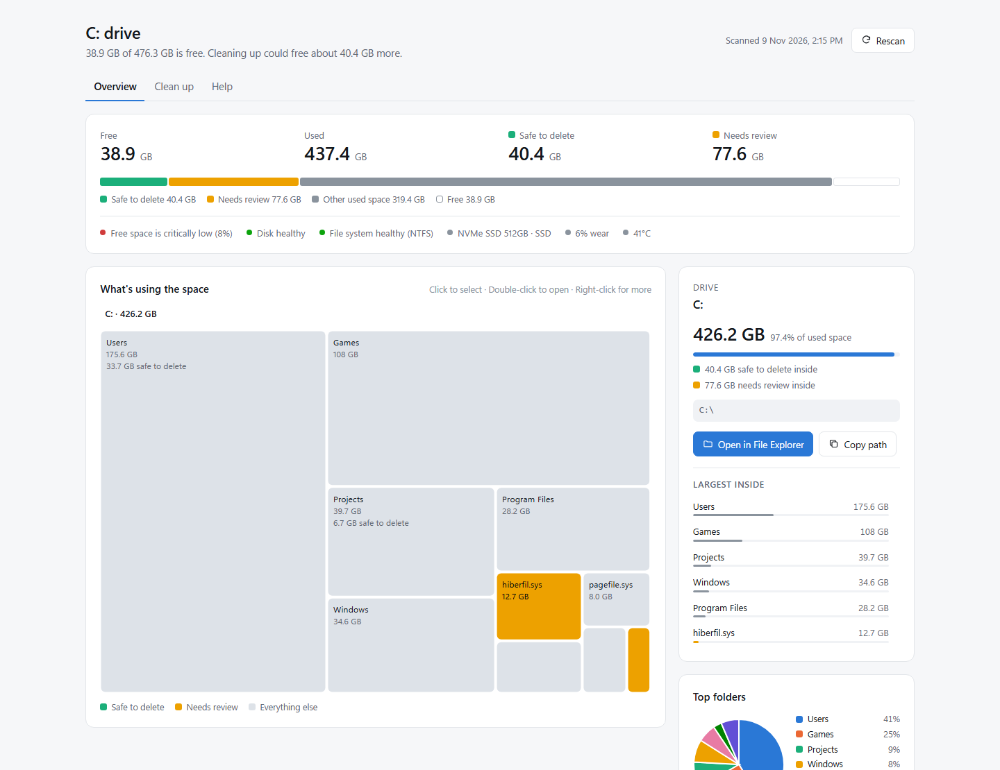
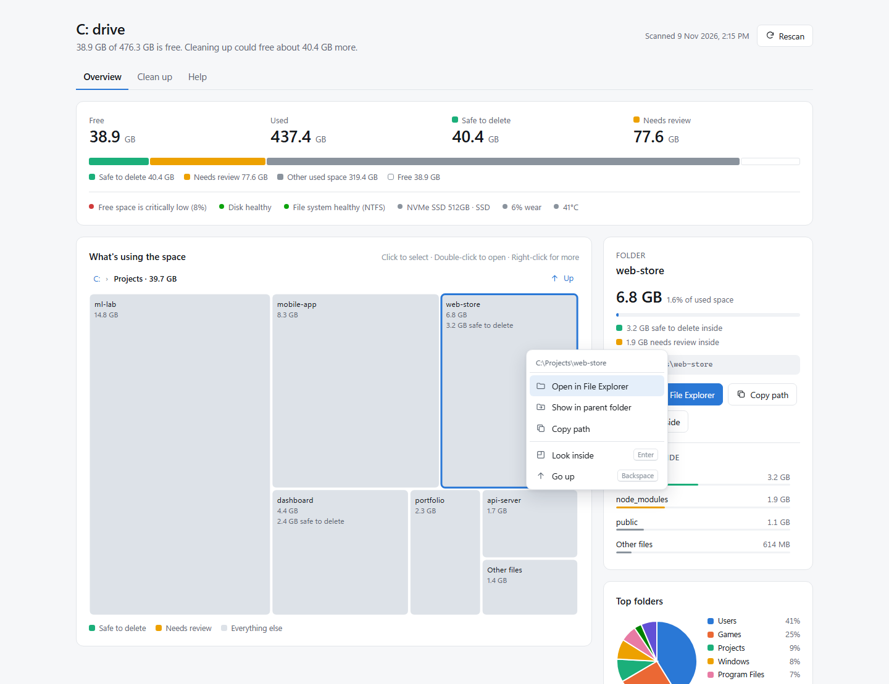
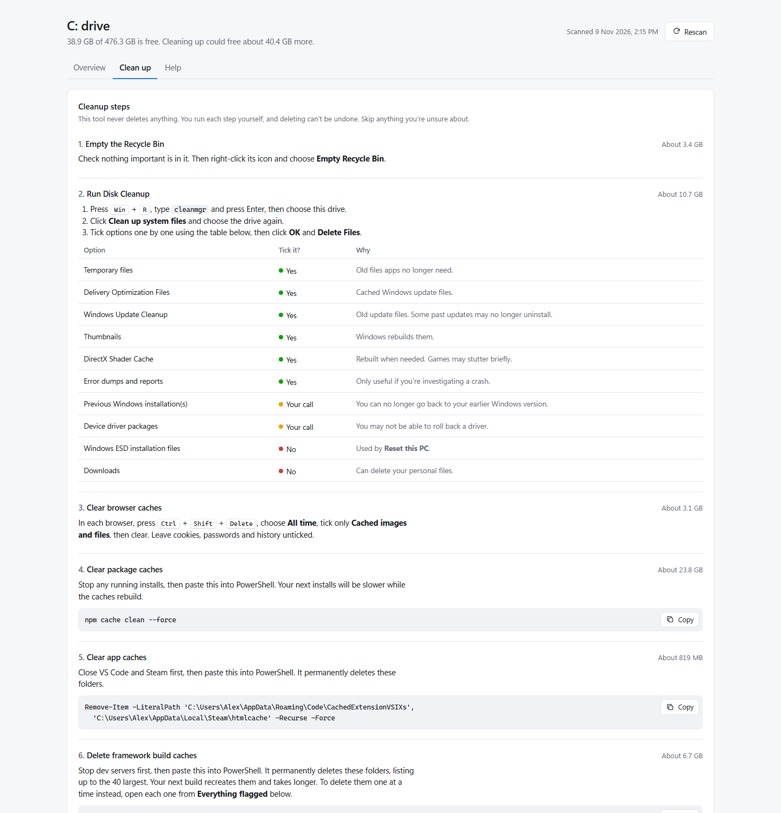

# DriveLens

**See what's filling your Windows drive, and clean it up safely.**

DriveLens scans a drive in seconds and opens a clear dashboard: a clickable map of your folders, what's safe to delete, what needs a second look, and step-by-step cleanup instructions. Right-click anything to open it in File Explorer.

It's free, portable and needs no installation. It only reads your drive and never deletes anything on its own.

<picture>
  <source media="(prefers-color-scheme: dark)" srcset="docs/screenshots/overview-dark.png">
  
</picture>

<sub>Screenshots use demo data.</sub>

## Why DriveLens

When a drive fills up, Windows doesn't tell you why. Disk Cleanup only covers system files, and deleting folders at random is risky. DriveLens shows exactly where the space went, so you can decide what to remove.

It's especially useful for developers, because it finds space that other cleanup tools miss:

- package caches such as npm, pip, uv, Yarn, pnpm, Gradle, NuGet, Cargo and Bun
- `node_modules` folders, Python environments, and Terraform folders across your projects
- framework build output such as `.next`, `.nuxt`, `.svelte-kit`, `.angular` and `.turbo`
- AI model caches from Hugging Face and Ollama, Docker data and Android emulators

## Features

- **Fast scan:** reads every folder in parallel, so a full drive usually takes under a minute.
- **Clickable treemap:** shows the biggest folders at each level. Double-click to look inside, with a breadcrumb to go back.
- **Open in File Explorer:** right-click any box to open it, show it in its parent folder, or copy its path.
- **Clear verdicts:** green means safe to delete, yellow means needs review, and each one explains why.
- **Cleanup guide:** gives steps and copy-ready commands with current sizes, plus which Disk Cleanup options are safe to tick.
- **Drive health:** shows free space status, disk and file system health, and SSD wear and temperature when available.
- **Any drive:** copy the folder to any drive and it scans that drive.
- **Rescan:** see how much you recovered without leaving the page.
- **Light and dark mode:** follows your Windows theme.

## Screenshots

### Right-click to open any folder in File Explorer

<picture>
  <source media="(prefers-color-scheme: dark)" srcset="docs/screenshots/right-click-dark.png">
  
</picture>

### Step-by-step cleanup guide

<picture>
  <source media="(prefers-color-scheme: dark)" srcset="docs/screenshots/cleanup-dark.png">
  
</picture>

## Quick start

1. Download this repository: click **Code**, then **Download ZIP**, and extract it.
2. Double-click **`DriveLens.cmd`**.
3. Wait for the scan. The dashboard opens in your browser.

For fuller results on your Windows drive, right-click `DriveLens.cmd` and choose **Run as administrator**. This lets it measure protected folders such as the Windows Update cache, and it may also show SSD wear and temperature.

Keep the small console window open while you use the dashboard. It closes by itself about a minute after you close the page.

## Scan another drive

Copy the whole folder to the drive you want to scan, such as `D:\DriveLens`, and run it from there. DriveLens always scans the drive it's on.

To scan a different drive without moving the folder, run this from the DriveLens folder:

```powershell
powershell -NoProfile -ExecutionPolicy Bypass -File .\DriveLens.ps1 -Drive E
```

| Option | What it does |
|---|---|
| `-Drive E` | Scan drive E instead of the drive DriveLens is on |
| `-NoServer` | Only write the report file, without the File Explorer and Rescan buttons |
| `-NoOpen` | Don't open the browser automatically |

## How to use the dashboard

| Action | Result |
|---|---|
| Click a box | Select it and show its size, location and advice |
| Double-click, or press Enter | Look inside a folder |
| Right-click, or press Shift + F10 | Open in File Explorer, show in parent folder, or copy path |
| Backspace | Go up one folder |

## What the colors mean

| Color | Meaning | What to do |
|---|---|---|
| Green | Safe to delete | Caches and build output that rebuild themselves. Follow the **Clean up** tab. |
| Yellow | Needs review | Could be safe, but check first. Each item explains why. |
| Gray | Everything else | Leave it unless you know what it is. |

## Safety and privacy

- **Read-only:** DriveLens never deletes, moves or changes your files. You run every cleanup step yourself.
- **Stays on your PC:** nothing is uploaded anywhere. There's no telemetry, account or internet connection required.
- **Private local server:** while the dashboard is open, it's served from `127.0.0.1` so the page can open File Explorer. That server:
  - accepts connections from your own PC only
  - needs a one-time key that's only in your page
  - only opens locations found in the scan
- **One file written:** the only file it writes is `DriveLens-Report.html` in its own folder. That report lists your folder names, so don't share it publicly.

## Requirements

- Windows 10 or Windows 11
- Windows PowerShell 5.1, which comes with Windows
- Any modern browser

No installation, admin rights or extra software required.

## What it doesn't do

- It doesn't find duplicate files, or leftover folders from uninstalled apps.
- Drive health shows what Windows reports, not a full disk test.
- Without admin rights, some protected system folders are skipped.

## Customize what gets flagged

Detection rules live in the `$rules` list near the top of `DriveLens.ps1`. Each rule has a label, a verdict (`Safe`, `Review` or `Keep`), a short reason, and either exact paths or folder names to match. Pull requests with new rules are welcome.

## Project files

| File | Purpose |
|---|---|
| `DriveLens.cmd` | Double-click to run |
| `DriveLens.ps1` | Scans the drive, builds the dashboard and runs the local server |
| `template.html` | The dashboard's design, charts and cleanup guide |
| `docs/screenshots/` | Images used in this README |

## Contributing

Bug reports, ideas and pull requests are welcome. Open an issue to report a problem or suggest a new cache or folder that DriveLens should detect.

## Author

Created by **Umair Habib** ([@Umair-Habibx123](https://github.com/Umair-Habibx123)).

If DriveLens helped you free up space, consider giving it a ⭐ on GitHub so others can find it.

## License

[MIT](LICENSE) © 2026 Umair Habib
